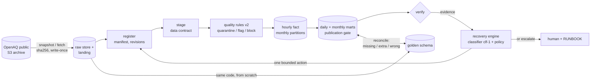
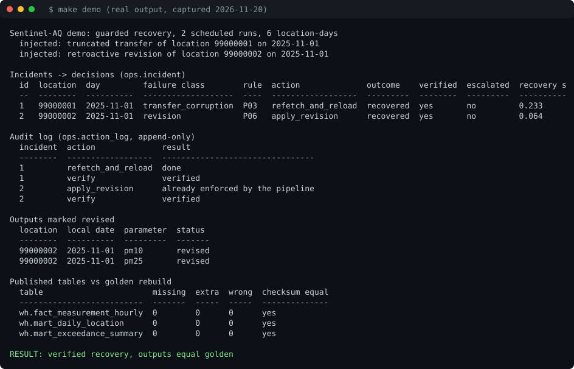
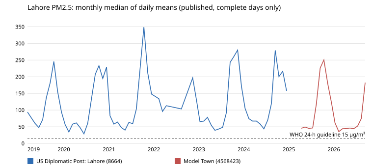
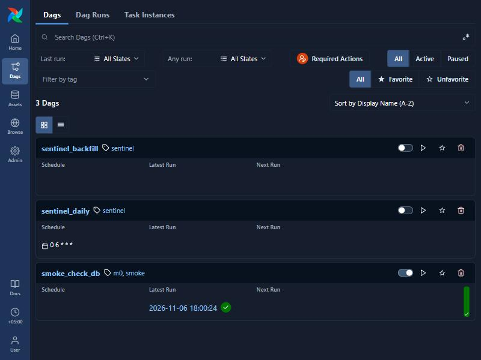
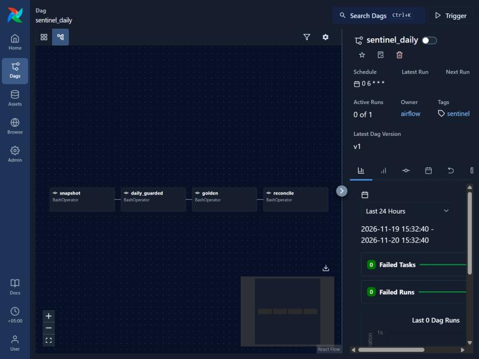
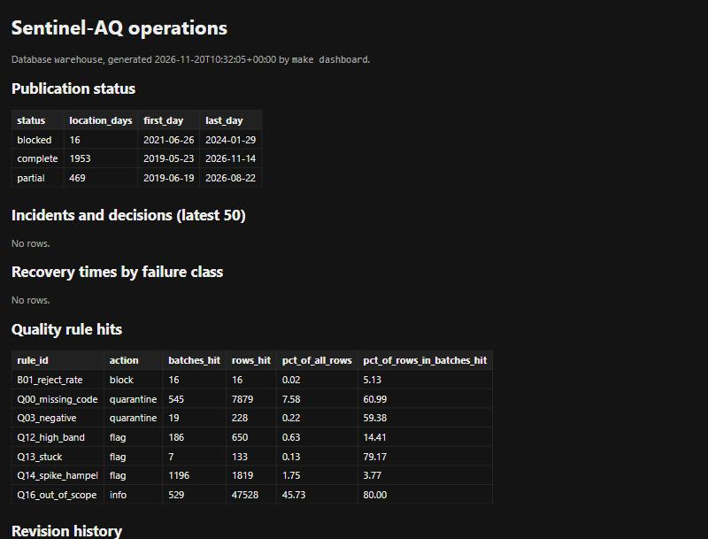

# Sentinel-AQ

**Correctness-verified recovery for an incremental air-quality data pipeline**, built and
evaluated on real OpenAQ PM2.5 data from Lahore, Pakistan.

[](https://github.com/Alimoiez22/sentinel-aq/actions/workflows/ci.yml)


**Author:** Ali Moiez · **Status:** v1.0, complete and reproducible; real-world revision
study (Track B) is collecting data · [Cite this project](CITATION.cff)

---

## Why this project exists

Lahore has some of the most polluted air in the world, and the public record of it flows
through data pipelines. Pipelines break: files arrive late, truncated, duplicated or
retroactively revised; processes crash; units and schemas drift. A pipeline that
"finishes" after such a failure can still publish **wrong numbers**, which is worse than
publishing nothing.

**Research question.** When a daily batch pipeline breaks, does *guarded* automatic
recovery (a deterministic classifier, one allow-listed and bounded action, escalation to
a human otherwise) leave the **published numbers correct** more often than plain retries,
without acting where a human should decide?

Success is never "the job finished". Every result is checked against a **golden
rebuild**: everything recomputed from scratch and compared row by row with what was
published.

## Results at a glance

| | |
|---|---|
| Real data processed | **2,438 location-days** (US Diplomatic Post reference monitor, 2019–2025; AirGradient sensor in Model Town, 2025–2026) |
| Published vs golden (real data) | **0 missing, 0 extra, 0 wrong rows** across 48,291 hourly facts, 2,438 daily rows, 88 monthly rows ([evidence](results/reconcile_latest.json)) |
| Fault experiments | **320 trials** (15 fault types + baseline × 2 modes × 5 held-out seeds, on synthetic and on real files) |
| Handled as expected (correct output *and* correct escalation) | guarded **70/75** vs retries-only **40/75**, identical on synthetic and real data |
| Wrong values published | **0** in every trial, both modes |
| Lahore finding | reference monitor: **1,448 of 1,464** complete days above the WHO 24-h PM2.5 guideline (15 µg/m³) ([report](results/lahore_pm25.md)) |
| Quality | 144 automated tests (unit, integration, property-based), `ruff`, `mypy --strict`, CI including a fresh-clone `make setup && make demo` |

## Architecture



Every stage runs in **one transaction** under an advisory lock on the location-day and
writes its checkpoint inside that transaction, so a crash leaves all or nothing, and a
rerun resumes. Every write **replaces** a location-day, so replays are idempotent. The
same mart SQL runs on the live and golden schemas. Details: [ARCHITECTURE](docs/ARCHITECTURE.md).

## Screenshots (real, from this repository)

**`make demo`**: an injected truncated transfer and a retroactive revision, detected,
classified, repaired by one policy action each, verified, and equal to golden:



**Lahore PM2.5** (`make lahore-report`), monthly median of published daily means, with
gaps where no complete day exists:



**Orchestration** (Airflow 3.3): the production DAG chains snapshot → guarded daily run →
golden rebuild → reconciliation:




**Operations dashboard** (`make dashboard`), generated from SQL views over the live
warehouse:



## Quickstart

Requirements: Docker Desktop, GNU Make, git. Run `make` from Git Bash or WSL (ADR-009).

```bash
git clone https://github.com/Alimoiez22/sentinel-aq.git && cd sentinel-aq
make setup        # .env from .env.example, build images (slow the first time)
make demo         # fault + revision -> verified recovery, compared with golden
make test         # lint, strict types, unit + integration + property tests
```

Reproduce the study on real Lahore data (public archive, no credentials):

```bash
make discover-csv                                   # locations + provenance (ADR-020)
make coverage LAHORE_ONLY=yes                       # coverage from listings
make fetch LOCATIONS="8664 4568423" CONFIRM=yes     # ~1.3 MB, resumable
make migrate && make run && make golden && make reconcile
make lahore-report
make experiment && make experiment-real && make analyse
make up-airflow                                     # optional: UI on http://127.0.0.1:8080
```

## Results

### Track A, synthetic data
<!-- results:start -->
Generated by `make analyse` from `experiments/results/results.csv` (faulty trials F1-F15; k/n = trials; times in seconds, median [IQR]).

| mode | trials | outputs_correct | handled_as_expected | recovered_verified | escalated | trials_with_damage | wrong_values_published | missing_location_days | summary_rows_wrong | inappropriate_actions | ttr_s_median_iqr_when_needed |
|---|---|---|---|---|---|---|---|---|---|---|---|
| retries_only | 75 | 60/75 | 40/75 | 60/75 | 0/75 | 15/75 | 0 | 15 | 30 | 0 | 0.991 [0.826, 1.012] |
| guarded | 75 | 70/75 | 70/75 | 50/75 | 25/75 | 5/75 | 0 | 5 | 10 | 0 | 0.152 [0.042, 0.182] |

Per fault: [experiments/results/results_table.md](experiments/results/results_table.md).
<!-- results:end -->

### Track A, real Lahore files
Same faults, modes, seeds and frozen classifier, starting from three smog-season days of
each real location.
<!-- results-real:start -->
Generated by `make analyse` from `experiments/results_real/results.csv` (faulty trials F1-F15; k/n = trials; times in seconds, median [IQR]).

| mode | trials | outputs_correct | handled_as_expected | recovered_verified | escalated | trials_with_damage | wrong_values_published | missing_location_days | summary_rows_wrong | inappropriate_actions | ttr_s_median_iqr_when_needed |
|---|---|---|---|---|---|---|---|---|---|---|---|
| retries_only | 75 | 60/75 | 40/75 | 60/75 | 0/75 | 15/75 | 0 | 15 | 10 | 0 | 0.964 [0.935, 1.002] |
| guarded | 75 | 70/75 | 70/75 | 50/75 | 25/75 | 5/75 | 0 | 5 | 4 | 0 | 0.146 [0.042, 0.168] |

Per fault: [experiments/results_real/results_table.md](experiments/results_real/results_table.md).
<!-- results-real:end -->

**How to read this.** "Recovered without a human" is higher for retries-only (60 vs 50)
because retries-only *silently* blocks bad upstream data, while guarded escalates the five
fault types that need a human decision (unknown schema, unknown unit, time-zone error,
mass corruption). `handled_as_expected` scores both outcome and escalation, and that is
where the modes differ. Guarded's only failures are F5 (unknown schema), which waits for a
human **by design**. Metric definitions: [EXPERIMENTS](docs/EXPERIMENTS.md).

## What makes this rigorous

- **Golden rebuild + order-independent comparators.** Correctness is measured, not
  assumed (ADR-014, ADR-017).
- **Property-based test.** Any sequence of arrivals, duplicates, replays and revisions
  converges to golden. A deliberately injected bug made it fail.
- **Held-out evaluation.** The classifier was frozen before evaluation seeds 11–15 ran;
  it was correct in 80/80 guarded trials on each dataset.
- **Findings on real data, fixed through documented process:**
  - `-999` missing-value codes were blocking 392 days; rules v2 treat them as missing
    hours, and blocked days fall to 16, recomputed from the raw files
    ([evidence](results/quality_rules_v1_vs_v2.csv), ADR-021).
  - A fault-injector flaw only showed on real multi-parameter files; it was fixed and
    the experiments were rerun (ADR-022).
- **22 architecture decision records**, a RUNBOOK for every escalation, and an honest
  [LIMITATIONS](docs/LIMITATIONS.md) list.

## Repository map

| Topic | File |
|---|---|
| Research brief and sources | [docs/RESEARCH.md](docs/RESEARCH.md), [docs/references.bib](docs/references.bib) |
| Architecture, grain, correctness mechanisms | [docs/ARCHITECTURE.md](docs/ARCHITECTURE.md) |
| Data contract and header variants | [docs/DATA_CONTRACT.md](docs/DATA_CONTRACT.md) |
| Quality rules | [docs/QUALITY_RULES.md](docs/QUALITY_RULES.md) |
| Fault catalogue F1–F15 | [docs/FAULTS.md](docs/FAULTS.md) |
| Recovery policy and classifier | [docs/POLICY.md](docs/POLICY.md) |
| Operator runbook | [docs/RUNBOOK.md](docs/RUNBOOK.md) |
| Experiments and metrics | [docs/EXPERIMENTS.md](docs/EXPERIMENTS.md) |
| Decisions (ADR-001…022) | [docs/DECISIONS.md](docs/DECISIONS.md) |
| Limitations | [docs/LIMITATIONS.md](docs/LIMITATIONS.md) |

## Status and future work

- **Done (v1.0):** pipeline, quality rules, warehouse, golden rebuild, fault catalogue,
  recovery engine, Airflow DAGs, dashboard, both experiment tracks on synthetic and real
  data, CI.
- **In progress, Track B:** daily snapshots record every file version, so real upstream
  revisions become measurable (`make revisions-report`); a meaningful window needs
  several weeks.
- **Future work:** a manual-operator baseline (`make manual-start` / `make manual-finish`);
  complete location discovery with an OpenAQ API key; more Lahore sensors.

## Data, licence and acknowledgements

- Data: [OpenAQ](https://openaq.org), via its public AWS archive. Licences vary by
  provider (Model Town / AirGradient: CC BY 4.0; US Diplomatic Post: not stated on its
  OpenAQ page). No downloaded data is committed. `data/fixtures/synthetic/` holds
  **synthetic** files generated with a fixed seed.
- WHO Global Air Quality Guidelines (2021) values: [config/guidelines.yaml](config/guidelines.yaml).
- Code: [MIT](LICENSE) © 2026 Ali Moiez.
- Developed by Ali Moiez with AI pair-programming assistance (Claude, Anthropic); the
  decision log records which decisions were proposed by the assistant and awaits the
  author's review.
